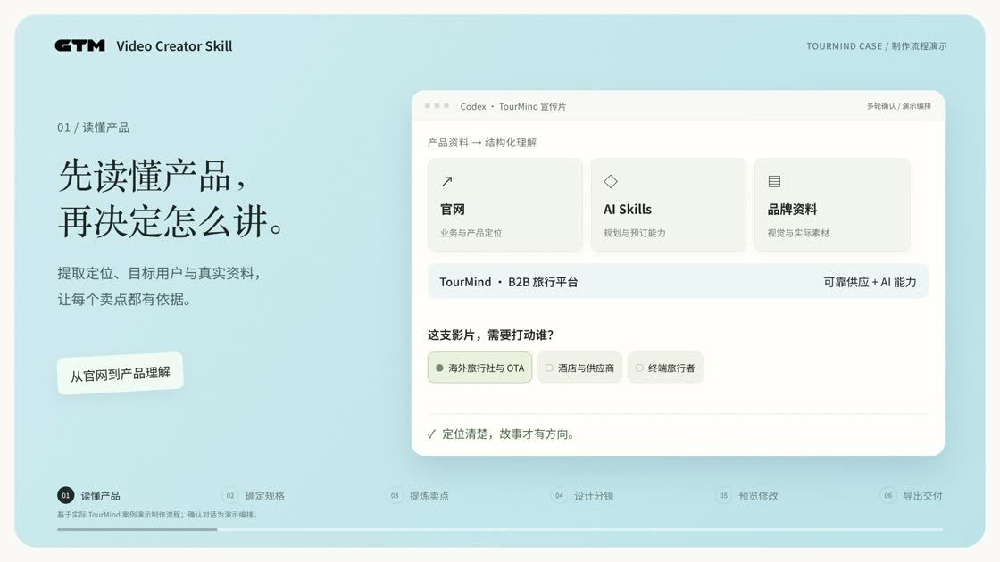
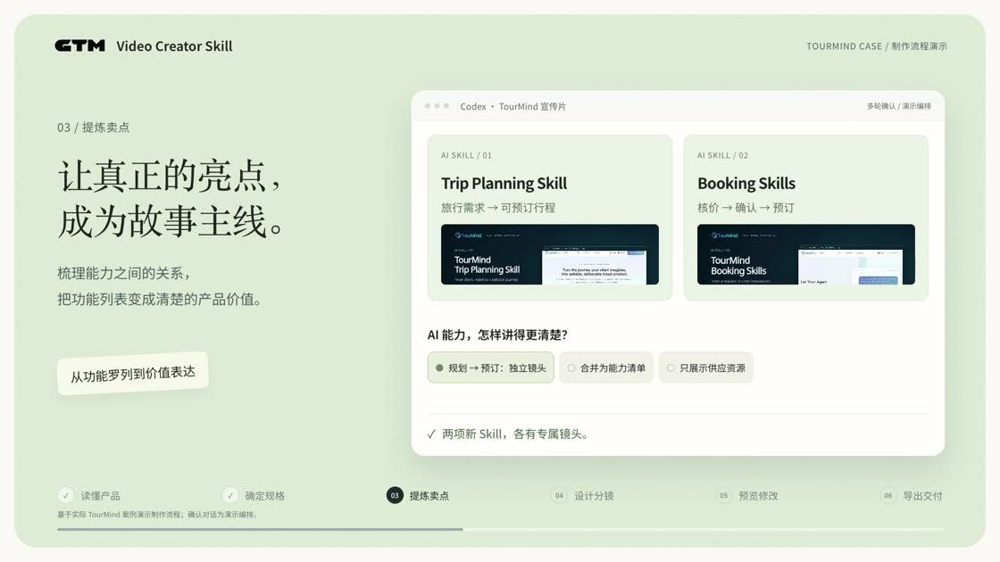
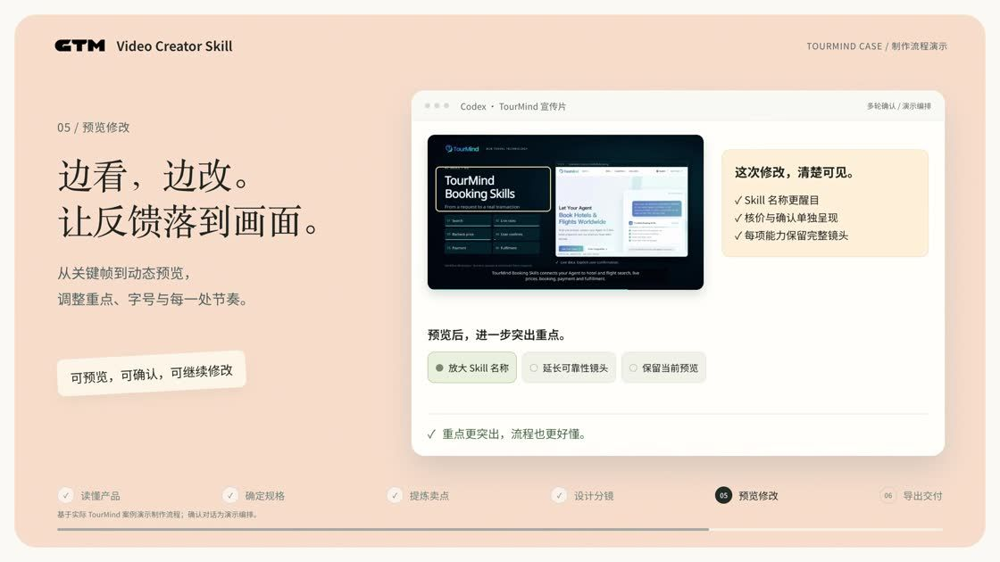
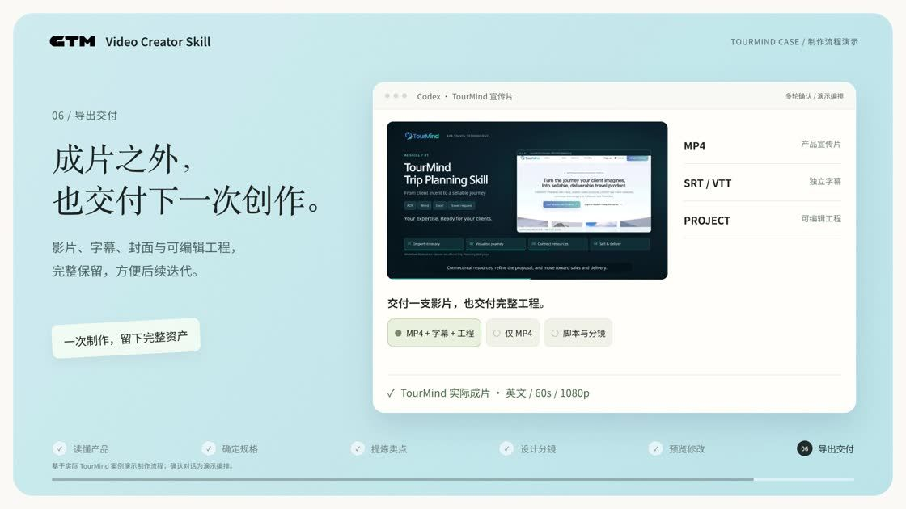

# GTM · Video Creator Skill

[English](README.en.md) · Created by Seigi


**每一个产品，都值得一个好故事。**

提供项目地址、产品官网或文件，通过对话完成产品分析、脚本分镜、品牌设计、动态画面与多语言交付。Skill 名称为 **Gotomaket-Video-Creator**，调用名为 `$gotomaket-video-creator`。

## 从链接到成片

1. **读懂产品**：查阅真实资料，明确用户、定位与可验证卖点。
2. **确定规格**：确认受众、语言、时长、比例与发布渠道。
3. **提炼卖点**：选择故事主线，避免堆砌功能。
4. **设计分镜**：确定脚本、品牌视觉、画面与动效。
5. **预览修改**：查看关键帧与影片，把反馈落实到具体镜头。
6. **导出交付**：输出 MP4、字幕、封面、脚本及可编辑工程。



以 TourMind 为例，先建立“可靠供应 + AI 能力”的叙事，再突出 Trip Planning Skill 与 Booking Skills。



通过多轮确认调整画面、节奏和文案；已确认内容沿用到后续步骤。



交付可播放的影片，同时保留继续迭代的素材和工程。



以上图片来自 **72 秒中文流程介绍片**，无配音、含原创背景音乐。对话界面是基于真实案例制作的流程演示，不是历史聊天录屏。本仓库只发布 Skill 和说明配图，不包含影片或官网工程。

## 安装到 Codex

复制下面这段话发给 Codex：

```text
请从 https://github.com/Seigino1/Gotomaket-Video-Creator 安装 gotomaket-video-creator Skill。
Skill 位于仓库的 skills/gotomaket-video-creator 目录，请完整安装到当前 Codex 的用户 skills 目录，保留所有子目录与依赖文件。
若已有同名 Skill，请先比较版本并备份，再更新。安装后检查 SKILL.md 和相对引用，告诉我如何调用；不要把仓库中的 demo 或压缩包放进 Skill 目录。
```

安装完成后，在新会话中使用：

```text
用 $gotomaket-video-creator，根据 https://example.com 制作产品宣传视频。
先分析产品，再和我确认受众、语言、脚本与视觉方向。优先使用当前订阅能力和本地工具。
```

也可在 [Releases](https://github.com/Seigino1/Gotomaket-Video-Creator/releases/latest) 下载完整 Skill ZIP。解压后将 `gotomaket-video-creator` 文件夹放入 `~/.codex/skills/`。其他 Agent 可放入其支持的 Skills 目录，或直接读取 `SKILL.md`。

## 能力与依赖

- **核心**：当前 Agent 会话能力 + 本地制片，无需额外配置模型 API Key。
- **渲染**：HyperFrames 或 Remotion，每部影片使用一个主引擎；包含模板与依赖锁文件。
- **方法**：结合归藏产品视频流程等多个视频生成工作流、Remotion 最佳实践、Prompt Motion 作为参考。
- **可选**：Higgsfield 素材生成，默认关闭；账号、授权与费用另行处理。
- **环境**：Python 3.9+、Node.js 22+、npm、浏览器、FFmpeg/FFprobe。仅安装选用引擎的依赖。

## 目录与反馈

| 目录 | 内容 |
|---|---|
| `skills/gotomaket-video-creator/` | 完整可安装 Skill、提示词、模板、脚本与上游参考 |
| `docs/images/` | 压缩封面与视频功能截图，合计约 364 KB |

[提交使用反馈](https://alidocs.dingtalk.com/notable/share/form/v01NpQlK57AQbbQDqDv_wSW69Lr_Jw8xtNM?source=link)

上游来源与许可证见 [sources.md](skills/gotomaket-video-creator/references/sources.md)。归藏快照保留 AGPL-3.0；框架、字体及案例素材各自的权利与使用条款保持不变。
